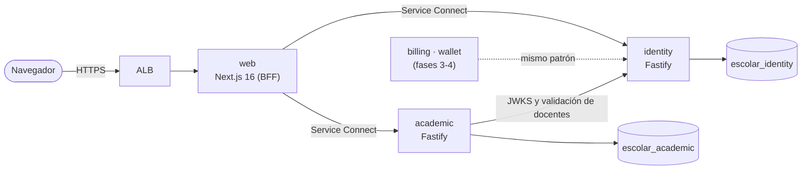

# Plataforma Escolar

Plataforma para centros educativos de Honduras, pensada para presentarse a una **Dirección
Departamental de Educación**:

- La **dirección departamental** (y la distrital) ve en un tablero cómo van todos sus centros:
  alumnos, maestros, licencias y, sobre todo, **clases que se quedaron sin maestro**.
- Cada **dirección de escuela** entra con el logo de su centro, gestiona alumnos y maestros y, cuando
  alguien sale de vacaciones o se enferma, **asigna sustitutos** a sus clases.
- Los **maestros** tienen una sola cuenta aunque trabajen en dos escuelas (matutina y vespertina).

Para colegios privados quedan además facturación (con CAI) y wallet de cafetería.

> Nombre provisional. Se cambia en `apps/web/src/lib/brand.ts`.

## Estado

| Fase | Contenido                                                                                                   | Estado    |
| ---- | ----------------------------------------------------------------------------------------------------------- | --------- |
| 0    | Monorepo, CI, login, colegios (multi-tenant), usuarios y roles, infraestructura en AWS                      | ✅ Listo  |
| 1    | Matrícula: estructura académica, alumnos, familias, cupos, importación desde Excel                          | ✅ Listo  |
| 2    | Departamento → distrito → centro, maestros en varios centros, licencias y sustitutos, tablero departamental | ✅ Listo  |
| 3    | Planificación semanal de docentes con revisión de coordinación                                              | Siguiente |
| 4    | Asistencia y notas, boletas en PDF                                                                          | Pendiente |
| —    | Para colegios privados: facturación con CAI y wallet de cafetería                                           | Después   |

## Arquitectura



- **`apps/web`**: Next.js 16 (App Router). Funciona como _backend for frontend_: el navegador solo
  tiene cookies httpOnly, y es el servidor de Next el que llama a los microservicios.
- **`services/identity`**: colegios (tenants), usuarios, roles, login y emisión de tokens.
- **`services/academic`**: año lectivo, grados, secciones con cupo, materias, docentes por materia,
  alumnos, responsables (familias), matrícula, retiros, cambios de sección e importación desde Excel.
  No tiene la llave privada: verifica los tokens con el JWKS público de identity, y para validar a un
  docente consulta a identity reenviando el token de quien hace la petición.
- **`packages/service-kit`**: base común de todos los microservicios (servidor, errores, logs,
  verificación de tokens, configuración, conexión a Postgres y migraciones). Cada servicio crea su
  propia base de datos al arrancar si no existe.
- **`packages/shared`**: tipos, validaciones (Zod) y utilidades de dinero compartidas con el frontend.
- **`infra`**: AWS CDK (VPC, RDS, ECS Fargate con Service Connect, ALB).

Cada microservicio tiene **su propia base de datos** (mismo servidor Postgres en desarrollo, mismo
RDS en AWS) y nunca lee la base de otro: se comunican por API (y, desde facturación, por eventos).

## Decisiones importantes (software financiero)

- **Dinero en centavos enteros.** Nada de `float`. `packages/shared/src/money.ts` tiene el parseo,
  el formato en Lempiras, el ISV por puntos básicos con redondeo explícito y el reparto en cuotas
  sin perder centavos.
- **El colegio sale del token, nunca del body ni de la URL.** `tenantOf(request)` es la única
  fuente del tenant. Hay tests que intentan crear o modificar datos de otro colegio.
- **Tokens firmados con Ed25519.** Identity firma con la llave privada; el resto de servicios solo
  verifica con la pública (`/.well-known/jwks.json`). Comprometer un servicio de negocio no permite
  falsificar sesiones.
- **Refresh tokens con rotación y detección de robo.** Si un token ya usado se vuelve a presentar
  fuera de la ventana de gracia (30 s, para peticiones paralelas del navegador), se revoca toda la
  sesión.
- **Una persona, una cuenta, varios accesos.** Las membresías dan a cada persona un rol en un centro,
  distrito o departamento; un `CHECK` en Postgres impide que un rol quede con el ámbito equivocado.
  La sesión trabaja con un acceso y se cambia de centro sin volver a escribir la contraseña.
- **Quién ve qué centros lo decide identity.** El tablero regional de academic pide a identity
  (reenviando el token de la sesión) la lista de centros visibles; academic nunca lo decide solo.
- **Licencias y sustituciones con fechas.** Al terminar la licencia, la clase vuelve sola a su titular.
  No se cruzan licencias del mismo maestro (bloqueo por maestro) ni se puede poner de sustituto a
  alguien que también está de licencia.
- **Aislamiento entre colegios también en la base de datos.** En `academic` las llaves foráneas son
  compuestas `(school_id, id)`: aunque la API tuviera un bug, Postgres rechaza una sección colgada de
  un grado de otro colegio o una matrícula en una sección ajena.
- **Cupos sin sobreventa.** Matricular bloquea la fila de la sección (`SELECT … FOR UPDATE`) antes de
  contar. Probado contra Postgres real con 20 matrículas simultáneas en una sección de cupo 5: con el
  bloqueo entran 5; sin él entraban 8 (`services/academic/test/race.manual.ts`).
- **Importación todo o nada.** La vista previa valida cada fila (con su número) sin crear nada; al
  confirmar, todo se crea en una sola transacción. Excel suele guardar la identidad como número y
  borra el cero inicial (0801… → 801…): se restaura al leer el archivo.
- **Bitácora de auditoría de solo inserción.** Un trigger de Postgres impide `UPDATE` y `DELETE`.
- **Login sin enumeración de usuarios.** El mismo mensaje y el mismo tiempo de respuesta para correo
  inexistente o contraseña incorrecta. Límite de 10 intentos por minuto por IP. Contraseñas con Argon2id.
- **Logs JSON con datos sensibles ocultos** (`authorization`, cookies, contraseñas, tokens) y un id
  de petición que viaja entre servicios y aparece en los errores que ve el usuario.

## Desarrollo local

Requisitos: Node 22+, pnpm 10 (`corepack enable`) y Docker (o un Postgres 16 propio).

```bash
pnpm install
```

```bash
docker compose up -d
```

```bash
cp services/identity/.env.example services/identity/.env
```

```bash
cp services/academic/.env.example services/academic/.env
```

```bash
cp apps/web/.env.example apps/web/.env.local
```

```bash
pnpm keys:generate >> services/identity/.env
```

```bash
pnpm db:migrate
```

```bash
pnpm db:seed
```

```bash
pnpm dev
```

Con los servicios corriendo, en otra terminal, carga el Colegio Demo (años, grados, secciones,
materias, docentes y 10 alumnos con hermanos). Se carga **a través de las APIs**, igual que el panel:

```bash
pnpm db:seed:demo
```

Para una **presentación a una departamental**, carga además el departamento de demostración
"Islas de la Bahía": 4 distritos, 7 escuelas públicas **ficticias** con logo, maestros (una en dos
escuelas), unos 340 alumnos y licencias con y sin sustituto:

```bash
pnpm db:seed:region
```

Cuentas de la demo (contraseña `SEED_DEMO_PASSWORD`): `departamental@demo-ihb.hn`,
`distrital.roatan@demo-ihb.hn`, `director@demo-oak-ridge.hn` (tiene clases sin maestro) y
`shanice.bodden@demo-ihb.hn` (maestra en dos escuelas).

- Panel: http://localhost:3000. Identity: http://localhost:3001. Academic: http://localhost:3002.
- Usuarios de prueba (con `SEED_DEMO=true`): `superadmin@escolar.local` con `SEED_SUPERADMIN_PASSWORD`,
  y `admin@`, `coordinacion@`, `finanzas@`, `secretaria@`, `docente@`, `docente2@` y
  `padre@colegio-demo.hn` con `SEED_DEMO_PASSWORD`.
- Todo en contenedores, como en AWS: `docker compose --profile full up --build`.

## Calidad

```bash
pnpm lint
```

```bash
pnpm typecheck
```

```bash
pnpm test
```

- Los tests de `identity` y `academic` levantan un **Postgres real en memoria (PGlite)** con las
  migraciones reales: no necesitan Docker y corren igual en CI.
- Los tests de `infra` verifican la seguridad de la infraestructura (base no pública y cifrada,
  security groups, secretos fuera de variables en claro, rollback automático).
- CI (GitHub Actions) corre lint, tipos, tests, build, `cdk synth` y construye las tres imágenes
  Docker en cada push y pull request.

## Despliegue en AWS

La primera vez:

1. Configura credenciales de AWS y prepara la cuenta para CDK:

   ```bash
   pnpm --filter @escolar/infra exec cdk bootstrap
   ```

2. Crea el secreto con las llaves JWT. Nunca se guardan en git:

   ```bash
   pnpm -s keys:generate --json > jwt.json
   ```

   ```bash
   aws secretsmanager create-secret --name escolar/dev/identity-jwt --secret-string file://jwt.json
   ```

   ```bash
   rm jwt.json
   ```

3. Despliega con el ARN completo que devolvió el paso anterior:

   ```bash
   pnpm --filter @escolar/infra exec cdk deploy --all -c jwtSecretArn=arn:aws:secretsmanager:...
   ```

   Para HTTPS agrega `-c certificateArn=arn:aws:acm:...` (certificado de ACM para tu dominio).
   **Sin certificado el panel queda en HTTP: sirve para probar, nunca para datos reales.**

4. Crea el superadmin corriendo el seed una vez como tarea de ECS. Los valores salen de las
   salidas (_outputs_) del despliegue:

   ```bash
   aws ecs run-task --cluster <NombreCluster> --task-definition <IdentityTaskDefinition> --launch-type FARGATE --network-configuration "awsvpcConfiguration={subnets=[<SubredesPublicas>],securityGroups=[<IdentitySecurityGroup>],assignPublicIp=ENABLED}" --overrides '{"containerOverrides":[{"name":"identity","command":["node","dist/scripts/seed.js"],"environment":[{"name":"SEED_SUPERADMIN_EMAIL","value":"tu-correo@dominio.hn"},{"name":"SEED_SUPERADMIN_PASSWORD","value":"una-clave-larga-y-unica"}]}]}'
   ```

Después, cada despliegue se hace desde GitHub Actions → **Desplegar en AWS** (manual), usando un rol
IAM con OIDC (secreto `AWS_DEPLOY_ROLE_ARN` y variable `JWT_SECRET_ARN`).

**Costo aproximado del ambiente `dev`:** ALB + tres tareas Fargate pequeñas + RDS `t4g.micro`, del
orden de 55 a 70 USD al mes (menos si la cuenta tiene capa gratuita de RDS). No usa NAT Gateway: las
tareas salen a internet por IP pública y los security groups bloquean toda entrada directa. Para
producción conviene pasar a subredes privadas con VPC endpoints.

## Estructura

```
apps/web                 Next.js 16: panel por rol, alumnos, estructura académica, usuarios, colegios
services/identity        Fastify + Drizzle + Postgres: auth, tenants, usuarios, auditoría
services/academic        Fastify + Drizzle + Postgres: estructura académica, alumnos y matrícula
  drizzle/               migraciones SQL versionadas
  test/                  tests de API contra Postgres en memoria
packages/service-kit     base común de microservicios
packages/shared          dinero, roles, validaciones y tipos compartidos
infra                    AWS CDK + tests de la infraestructura
docker-compose.yml       Postgres local (y todo el stack con --profile full)
```
