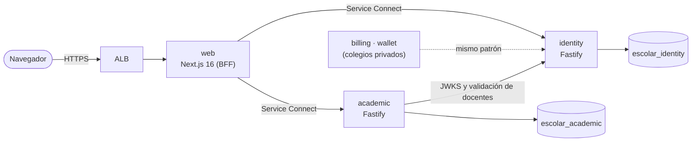

# Plataforma Escolar

Plataforma para centros educativos de Honduras, pensada para presentarse a una **Dirección
Departamental de Educación**:

- La **dirección departamental** (y la distrital) ve en un tablero cómo van todos sus centros:
  alumnos, maestros, licencias y, sobre todo, **clases que se quedaron sin maestro**.
- Cada **dirección de escuela** entra con el logo de su centro, gestiona alumnos y maestros y, cuando
  alguien sale de vacaciones o se enferma, **asigna sustitutos** a sus clases.
- Los **maestros** tienen una sola cuenta aunque trabajen en dos escuelas (matutina y vespertina),
  y llevan su **cuaderno** (asistencia diaria y notas por actividad) desde el teléfono, **aun sin
  internet**. Al cierre del parcial, las notas quedan listas para pasarlas al **SACE**.
- Cada semana el maestro entrega su **planificación** por clase; la dirección o coordinación la
  aprueba o la devuelve con observaciones, y la departamental ve qué centros van al día.
- Las **familias** entran con su número de identidad (o su correo) y ven las notas, la asistencia y
  las tareas de la semana de sus hijos, y su boleta para imprimir.
- Cada centro publica **avisos** (a familias o al personal), arma el **horario** de cada sección,
  registra el **seguimiento** de los alumnos en riesgo, emite **constancias** y hace **traslados** a
  otro centro del departamento, que recibe al alumno con su historial.
- Al terminar el año, cada clase tiene su **nota final** y la **recuperación** de quien no alcanzó la
  nota mínima; la dirección revisa y **pasa a todos al año siguiente** (promovidos, repiten o
  egresan) en un solo paso.

Para colegios privados quedan además facturación (con CAI) y wallet de cafetería.

> Nombre provisional. Se cambia en `apps/web/src/lib/brand.ts`.

## Estado

| Fase | Contenido                                                                                                   | Estado   |
| ---- | ----------------------------------------------------------------------------------------------------------- | -------- |
| 0    | Monorepo, CI, login, colegios (multi-tenant), usuarios y roles, infraestructura en AWS                      | ✅ Listo |
| 1    | Matrícula: estructura académica, alumnos, familias, cupos, importación desde Excel                          | ✅ Listo |
| 2    | Departamento → distrito → centro, maestros en varios centros, licencias y sustitutos, tablero departamental | ✅ Listo |
| 3    | Cuaderno del maestro sin internet (asistencia y notas por actividad), alerta temprana, cuadro para el SACE  | ✅ Listo |
| 4    | Planificación semanal con la plantilla del centro, revisión de dirección/coordinación e historial           | ✅ Listo |
| 5    | Portal de familias: notas, asistencia y tareas de sus hijos; acceso con identidad; boleta imprimible        | ✅ Listo |
| 6    | Piloto: corregir datos sin perder notas, Excel, indicadores del piloto, verificación en dos pasos (2FA)     | ✅ Listo |
| 7    | Escuela: avisos, horario, seguimiento, traslados, constancias, bitácora; nota final, recuperación, cierre   | ✅ Listo |
| —    | Para colegios privados: facturación con CAI y wallet de cafetería                                           | Después  |

## Arquitectura



- **`apps/web`**: Next.js 16 (App Router). Funciona como _backend for frontend_: el navegador solo
  tiene cookies httpOnly, y es el servidor de Next el que llama a los microservicios.
- **`services/identity`**: colegios (tenants), usuarios, roles, login y emisión de tokens.
- **`services/academic`**: año lectivo, grados, secciones con cupo, materias, docentes por materia,
  alumnos, responsables (familias), matrícula, retiros, cambios de sección, importación desde Excel,
  licencias y sustitutos, parciales, actividades y notas, asistencia, seguimiento y tablero regional.
  No tiene la llave privada: verifica los tokens con el JWKS público de identity, y para validar a un
  docente consulta a identity reenviando el token de quien hace la petición.
- **`packages/service-kit`**: base común de todos los microservicios (servidor, errores, logs,
  verificación de tokens, configuración, conexión a Postgres y migraciones). Cada servicio crea su
  propia base de datos al arrancar si no existe.
- **`packages/shared`**: tipos, validaciones (Zod) y utilidades de dinero compartidas con el frontend.
- **`infra`**: AWS CDK (VPC, RDS, ECS Fargate con Service Connect, ALB).

Cada microservicio tiene **su propia base de datos** (mismo servidor Postgres en desarrollo, mismo
RDS en AWS) y nunca lee la base de otro: se comunican por API (y, desde facturación, por eventos).

## Complemento del SACE

Los maestros de escuelas públicas ya registran las notas oficiales en el **SACE** de la Secretaría de
Educación. Esta plataforma **no lo reemplaza ni entra en él** (nunca pide ni guarda contraseñas del
SACE): cubre lo que pasa _antes_ de que las notas lleguen ahí.

| En el SACE                                             | Aquí                                                                                                     |
| ------------------------------------------------------ | -------------------------------------------------------------------------------------------------------- |
| Se ingresa la nota final del parcial, al cierre        | El maestro registra cada actividad durante el parcial y la nota se calcula sola (100 puntos por parcial) |
| Necesita internet y computadora                        | Funciona en el teléfono y **sin internet**; se sincroniza solo cuando vuelve la señal                    |
| La asistencia diaria se lleva en papel                 | Lista de asistencia en un toque por alumno (presente, ausente, tarde, justificada)                       |
| Los problemas se ven cuando el parcial ya cerró        | **Alerta temprana**: alumnos en riesgo por faltas o por la proyección de sus notas, antes del cierre     |
| La dirección no sabe qué maestros van atrasados        | Avance de notas por clase y aviso cuando el cierre está a 7 días o menos                                 |
| La departamental ve los datos cuando ya son históricos | Tablero con asistencia, alumnos en riesgo y centros atrasados, al día                                    |
| Las notas se transcriben a mano desde cuadernos        | **Cuadro de calificaciones** en Excel por sección (identidad, alumno, nota por materia) para el SACE     |

## Decisiones importantes

- **Verificación en dos pasos para quien ve muchos centros.** La departamental, la distrital y la
  plataforma activan un código de su teléfono (TOTP) la primera vez que entran; hasta entonces el
  panel no muestra nada más. En las demos queda opcional (`REQUIRE_MFA=false`).

- **Puesta en marcha sin correo.** La departamental carga sus centros (con cada director) y cada
  dirección a su personal desde Excel; todos entran con su número de identidad y una contraseña
  temporal que cambian al primer ingreso. Si alguien la olvida, quien está a cargo le da otra (solo
  dentro de su ámbito). Tras 5 intentos fallidos la cuenta se bloquea 15 minutos.

- **Dinero en centavos enteros.** Nada de `float`. `packages/shared/src/money.ts` tiene el parseo,
  el formato en Lempiras, el ISV por puntos básicos con redondeo explícito y el reparto en cuotas
  sin perder centavos.
- **El colegio sale del token, nunca del body ni de la URL.** `tenantOf(request)` es la única
  fuente del tenant. Hay tests que intentan crear o modificar datos de otro colegio.
- **Tokens firmados con Ed25519.** Identity firma con la llave privada; el resto de servicios solo
  verifica con la pública (`/.well-known/jwks.json`). Comprometer un servicio de negocio no permite
  falsificar sesiones.
- **Refresh tokens con rotación y detección de robo.** Si un token ya usado se vuelve a presentar
  fuera de la ventana de gracia (30 s, para peticiones paralelas del navegador), se revoca toda la
  sesión.
- **Una persona, una cuenta, varios accesos.** Las membresías dan a cada persona un rol en un centro,
  distrito o departamento; un `CHECK` en Postgres impide que un rol quede con el ámbito equivocado.
  La sesión trabaja con un acceso y se cambia de centro sin volver a escribir la contraseña.
- **Quién ve qué centros lo decide identity.** El tablero regional de academic pide a identity
  (reenviando el token de la sesión) la lista de centros visibles; academic nunca lo decide solo.
- **Licencias y sustituciones con fechas.** Al terminar la licencia, la clase vuelve sola a su titular.
  No se cruzan licencias del mismo maestro (bloqueo por maestro) ni se puede poner de sustituto a
  alguien que también está de licencia.
- **Aislamiento entre colegios también en la base de datos.** En `academic` las llaves foráneas son
  compuestas `(school_id, id)`: aunque la API tuviera un bug, Postgres rechaza una sección colgada de
  un grado de otro colegio o una matrícula en una sección ajena.
- **Cupos sin sobreventa.** Matricular bloquea la fila de la sección (`SELECT … FOR UPDATE`) antes de
  contar. Probado contra Postgres real con 20 matrículas simultáneas en una sección de cupo 5: con el
  bloqueo entran 5; sin él entraban 8 (`services/academic/test/race.manual.ts`).
- **Importación todo o nada.** La vista previa valida cada fila (con su número) sin crear nada; al
  confirmar, todo se crea en una sola transacción. Excel suele guardar la identidad como número y
  borra el cero inicial (0801… → 801…): se restaura al leer el archivo.
- **Cuaderno sin internet sin perder nada.** Cada cambio del maestro se anota al instante en el
  dispositivo (un diario en `localStorage` y una bandeja en IndexedDB) y se envía al volver la
  conexión. Las operaciones son idempotentes: el id de cada actividad lo genera el dispositivo y las
  notas y la asistencia se sobrescriben, así que reenviar no duplica. Si una nota se rechaza (p. ej.
  mayor al valor de la actividad), el maestro ve el motivo. Un service worker guarda solo las páginas
  del cuaderno, y se borran en la pantalla de inicio de sesión (dispositivos compartidos).
- **Planificación con historial y sin pisarse.** Cada planificación guarda una copia de los campos de
  la plantilla con que se creó (cambiar la plantilla no rompe las anteriores) y un número de versión:
  si se guarda desde dos ventanas, la segunda recibe un aviso en vez de borrar lo de la primera. La
  escribe el titular o quien lo cubre esa semana; la dirección revisa pero no escribe por otros.
- **Familias: solo lo de sus hijos.** La cuenta la crea la secretaría desde la ficha del alumno, con
  la identidad del encargado (muchas familias no usan correo) y una contraseña temporal fácil de
  dictar que se cambia al entrar. Si la persona ya tenía cuenta (maestra en otra escuela, hijos en
  otro centro) solo se le agrega el acceso. Cada consulta comprueba que el alumno es suyo y del centro
  de la sesión; la secretaría no puede restablecer la contraseña de alguien que también es personal.
- **Un parcial vale 100 puntos.** El servidor no deja repartir más, ni bajar el valor de una actividad
  por debajo de notas ya puestas, ni quitar un parcial que tiene notas. Solo califica quien da la
  clase (o su sustituto mientras dura la licencia) y la dirección.
- **Bitácora de auditoría de solo inserción.** Un trigger de Postgres impide `UPDATE` y `DELETE`.
- **Login sin enumeración de usuarios.** El mismo mensaje y el mismo tiempo de respuesta para correo
  inexistente o contraseña incorrecta. Límite de 10 intentos por minuto por IP. Contraseñas con Argon2id.
- **Logs JSON con datos sensibles ocultos** (`authorization`, cookies, contraseñas, tokens) y un id
  de petición que viaja entre servicios y aparece en los errores que ve el usuario.

## Mostrar la demo en una computadora (solo Docker)

Para presentarla no hace falta instalar Node ni nada más que
[Docker Desktop](https://www.docker.com/products/docker-desktop/). Descarga el repositorio (en GitHub:
**Code → Download ZIP**, y descomprímelo) y, en una terminal dentro de esa carpeta:

```bash
docker compose -f docker-compose.demo.yml up --build
```

La primera vez tarda unos minutos (construye las imágenes y carga la demo). Cuando aparezca
**"Demo lista"**, abre http://localhost:3000. Todas las cuentas usan la contraseña
`Demo-colegio-2026`:

| Cuenta                         | Para mostrar                                                         |
| ------------------------------ | -------------------------------------------------------------------- |
| `departamental@demo-ihb.hn`    | Tablero de los 7 centros: clases sin maestro, asistencia, riesgo     |
| `distrital.roatan@demo-ihb.hn` | Lo mismo, solo los centros del distrito de Roatán                    |
| `director@demo-oak-ridge.hn`   | Licencia sin sustituto: asignarlo y ver que la alerta desaparece     |
| `director@demo-west-end.hn`    | Seguimiento: notas atrasadas, alumnos en riesgo, cuadro para el SACE |
| `maestro4@demo-west-end.hn`    | Mi cuaderno (también sin internet) y planificación semanal           |
| `shanice.bodden@demo-ihb.hn`   | Maestra en dos escuelas: «Cambiar de centro»                         |
| `0000-2026-00001`              | Familia con dos hijos: notas, asistencia, tareas y boleta            |

Para apagarla, `Ctrl+C` (o `docker compose -f docker-compose.demo.yml stop`). Las fechas de la demo se
calculan desde el día en que se carga; para dejarla como nueva antes de una presentación:

```bash
docker compose -f docker-compose.demo.yml down -v
```

y se vuelve a levantar con el primer comando. Es solo para mostrar en la propia computadora: las
contraseñas son públicas y no usa HTTPS.

### Sin Docker (Windows, computadoras sin virtualización)

Si Docker Desktop no arranca ("Virtualization support not detected") y no se quiere tocar la BIOS,
la demo también corre directo en Windows. Instala [Node.js](https://nodejs.org) (versión LTS) y
[PostgreSQL](https://www.postgresql.org/download/windows/) (anota la contraseña del usuario
`postgres`), pon la carpeta del proyecto **fuera de OneDrive** (por ejemplo `C:\demo\appAlumnos-main`)
y, en PowerShell dentro de esa carpeta:

```bash
powershell -ExecutionPolicy Bypass -File .\scripts\demo-windows.ps1
```

La primera vez pide la contraseña de `postgres`, instala, compila y carga la demo (unos minutos);
después abre el navegador. Con `-Reiniciar` deja la demo como nueva y con `-Apagar` la apaga.

## Desarrollo local

Requisitos: Node 22+, pnpm 10 (`corepack enable`) y Docker (o un Postgres 16 propio).

```bash
pnpm install
```

```bash
docker compose up -d
```

```bash
cp services/identity/.env.example services/identity/.env
```

```bash
cp services/academic/.env.example services/academic/.env
```

```bash
cp apps/web/.env.example apps/web/.env.local
```

```bash
pnpm keys:generate >> services/identity/.env
```

```bash
pnpm db:migrate
```

```bash
pnpm db:seed
```

```bash
pnpm dev
```

Con los servicios corriendo, en otra terminal, carga el Colegio Demo (años, grados, secciones,
materias, docentes y 10 alumnos con hermanos). Se carga **a través de las APIs**, igual que el panel:

```bash
pnpm db:seed:demo
```

Para una **presentación a una departamental**, carga además el departamento de demostración
"Islas de la Bahía": 4 distritos, 7 escuelas públicas **ficticias** con logo, maestros (una en dos
escuelas), unos 320 alumnos, licencias con y sin sustituto, planificaciones semanales, asistencia del último mes y notas del
parcial (escuelas al día, atrasadas y una que no usa el cuaderno). Las fechas son relativas al día en
que se carga: el parcial vigente cierra en 6 días, para que se vean las alertas.

```bash
pnpm db:seed:region
```

Cuentas de la demo (contraseña `SEED_DEMO_PASSWORD`): `departamental@demo-ihb.hn`,
`distrital.roatan@demo-ihb.hn`, `director@demo-oak-ridge.hn` (tiene clases sin maestro),
`director@demo-west-end.hn` (atrasada con las notas), `maestro4@demo-west-end.hn` (cuaderno del
maestro) y `shanice.bodden@demo-ihb.hn` (maestra en dos escuelas).

- Panel: http://localhost:3000. Identity: http://localhost:3001. Academic: http://localhost:3002.
- Usuarios de prueba (con `SEED_DEMO=true`): `superadmin@escolar.local` con `SEED_SUPERADMIN_PASSWORD`,
  y `admin@`, `coordinacion@`, `finanzas@`, `secretaria@`, `docente@`, `docente2@` y
  `padre@colegio-demo.hn` con `SEED_DEMO_PASSWORD`.
- Todo en contenedores, como en AWS: `docker compose --profile full up --build`.

## Calidad

```bash
pnpm lint
```

```bash
pnpm typecheck
```

```bash
pnpm test
```

- Los tests de `identity` y `academic` levantan un **Postgres real en memoria (PGlite)** con las
  migraciones reales: no necesitan Docker y corren igual en CI.
- Los tests de `infra` verifican la seguridad de la infraestructura (base no pública y cifrada,
  security groups, secretos fuera de variables en claro, rollback automático).
- CI (GitHub Actions) corre lint, tipos, tests, build, `cdk synth` y construye las tres imágenes
  Docker en cada push y pull request.
- **Prueba de carga con un departamento completo:** `SEED_EXTRA_SCHOOLS=93 pnpm db:seed:region` (con
  `LOGIN_RATE_LIMIT_PER_MINUTE=5000` en identity) carga 100 centros y ~5,900 alumnos con un mes de
  asistencia y notas. Medido en una computadora: tablero departamental ~1.4 s, indicadores del piloto
  ~0.6 s, Excel del departamento ~1.5 s (los centros se calculan de 4 en 4).

## Despliegue en AWS

Para **producción con 100 centros** (dominio con HTTPS, dos zonas, autoescalado, WAF, alarmas por
correo, 30 días de respaldos y cómo restaurarlos) sigue [docs/despliegue.md](docs/despliegue.md);
cuesta del orden de US$210 al mes. La revisión de seguridad está en [docs/seguridad.md](docs/seguridad.md).
Lo de abajo es el ambiente `dev` (de pruebas).

La primera vez:

1. Configura credenciales de AWS y prepara la cuenta para CDK:

   ```bash
   pnpm --filter @escolar/infra exec cdk bootstrap
   ```

2. Crea el secreto con las llaves JWT. Nunca se guardan en git:

   ```bash
   pnpm -s keys:generate --json > jwt.json
   ```

   ```bash
   aws secretsmanager create-secret --name escolar/dev/identity-jwt --secret-string file://jwt.json
   ```

   ```bash
   rm jwt.json
   ```

3. Despliega con el ARN completo que devolvió el paso anterior:

   ```bash
   pnpm --filter @escolar/infra exec cdk deploy --all -c jwtSecretArn=arn:aws:secretsmanager:...
   ```

   Para HTTPS agrega `-c certificateArn=arn:aws:acm:...` (certificado de ACM para tu dominio).
   **Sin certificado el panel queda en HTTP: sirve para probar, nunca para datos reales.**

4. Crea el superadmin corriendo el seed una vez como tarea de ECS. Los valores salen de las
   salidas (_outputs_) del despliegue:

   ```bash
   aws ecs run-task --cluster <NombreCluster> --task-definition <IdentityTaskDefinition> --launch-type FARGATE --network-configuration "awsvpcConfiguration={subnets=[<SubredesPublicas>],securityGroups=[<IdentitySecurityGroup>],assignPublicIp=ENABLED}" --overrides '{"containerOverrides":[{"name":"identity","command":["node","dist/scripts/seed.js"],"environment":[{"name":"SEED_SUPERADMIN_EMAIL","value":"tu-correo@dominio.hn"},{"name":"SEED_SUPERADMIN_PASSWORD","value":"una-clave-larga-y-unica"}]}]}'
   ```

Después, cada despliegue se hace desde GitHub Actions → **Desplegar en AWS** (manual), usando un rol
IAM con OIDC (secreto `AWS_DEPLOY_ROLE_ARN` y variable `JWT_SECRET_ARN`).

**Costo aproximado del ambiente `dev`:** ALB + tres tareas Fargate pequeñas + RDS `t4g.micro`, del
orden de 55 a 70 USD al mes (menos si la cuenta tiene capa gratuita de RDS). No usa NAT Gateway: las
tareas salen a internet por IP pública y los security groups bloquean toda entrada directa. Para
producción conviene pasar a subredes privadas con VPC endpoints.

## Estructura

```
apps/web                 Next.js 16: panel por rol, cuaderno sin internet (service worker), seguimiento, alumnos, estructura académica, usuarios, colegios
services/identity        Fastify + Drizzle + Postgres: auth, tenants, usuarios, auditoría
services/academic        Fastify + Drizzle + Postgres: estructura, matrícula, licencias, notas, asistencia, tablero regional
  drizzle/               migraciones SQL versionadas
  test/                  tests de API contra Postgres en memoria
packages/service-kit     base común de microservicios
packages/shared          dinero, roles, validaciones y tipos compartidos
infra                    AWS CDK + tests de la infraestructura
docker-compose.yml       Postgres local (y todo el stack con --profile full)
```
